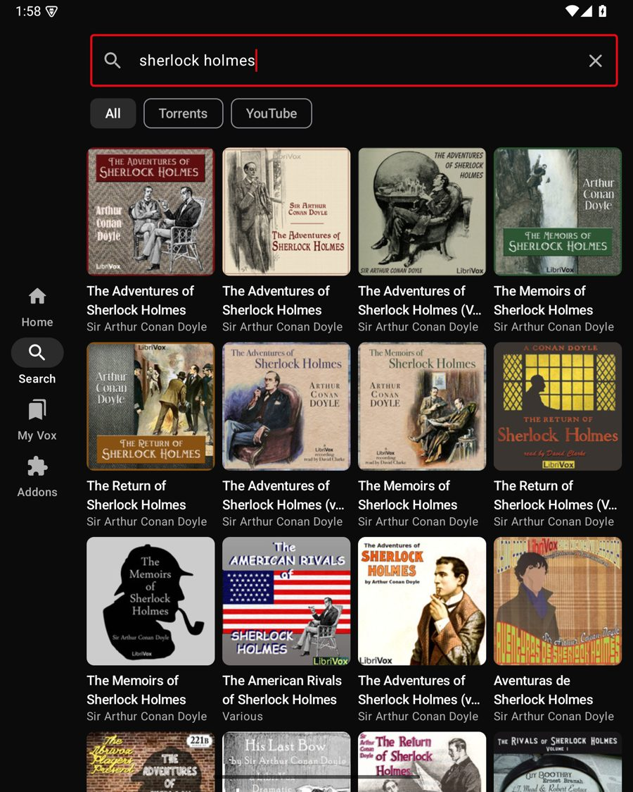

<p align="center">
  
</p>

<h1 align="center">Vox</h1>

<p align="center">
  <strong>The Open Source "Stremio for Audiobooks" for Android</strong><br>
  <em>A Netflix-style audiobook player with an addon system, LibriVox, Internet Archive, YouTube (yt-dlp) and torrent streaming. Free, no accounts, no ads.</em>
</p>

<p align="center">
  <a href="../../releases/latest">
    
  </a>
</p>

<p align="center">
  <a href="#-features">Features</a> •
  <a href="#-sources">Sources</a> •
  <a href="#-addons">Addons</a> •
  <a href="#-build">Build</a> •
  <a href="#-legal">Legal</a>
</p>

<p align="center">
  
  
  
  
  
  
</p>

---

<p align="center">
  
  &nbsp;
  
</p>

## What's new in 0.3: Books, page-curl reader and on-device narration

- **Ebook reader** for EPUB and TXT with a Kindle-style **page-curl** (the renderer from my Folio news app), paper / sepia / night themes, adjustable type, table of contents and remembered position.
- **Read aloud, fully offline**: [Piper](https://github.com/rhasspy/piper) neural voices run on the phone through [sherpa-onnx](https://github.com/k2-fsa/sherpa-onnx). The current sentence is highlighted and the page turns by itself while it reads. English (US/UK), Romanian, German, French and Spanish voices, ~65 MB each, downloaded once.
- **Ebook to audiobook converter**: one tap converts a book chapter by chapter into AAC files on the phone. The book is playable after the first chapter while the rest keeps converting (and an interrupted run resumes). It shows up on Home as "Made on this phone" and plays with resume, bookmarks, speed and sleep timer like any other audiobook.
- **Adaptive layout**: two-page spreads in the reader and list + detail panes on an unfolded Fold or tablet, a player that never needs scrolling, remaining time that follows the playback speed, and a **reading voice** picker in Settings.
- **Book and player stay in sync**: a converted book keeps a sentence-level timeline, so *Read along* jumps from the player to the exact sentence on the page (highlighted as it is spoken, pages turn by themselves) and turning a page moves the audiobook. Ebooks you read also show up in Continue Listening.
- **Fast conversion**: sentences are synthesised in parallel (several model instances at once) and *Settings > Conversion speed* measures your phone and picks the fastest setup. Voices: Piper (7 languages) and the optional multilingual Supertonic 3 (31 languages incl. Romanian).
- **Free classics**: search Project Gutenberg from the Books tab.

## What's new in 0.2

- **Resumes exactly where you stopped**: chapter and position are saved continuously; reopen the app and the mini player is back at that spot (smart rewind backs up a few seconds, more the longer you were away).
- **Resume buttons** with `Ch 5 · 12:34` on the hero and Continue Listening cards, **Finished** shelf and mark-as-finished.
- **Bookmarks** at any timestamp, per-book speed memory, speeds up to 3x, **skip silence**, sleep timer with *end of chapter*.
- **Auto-update from GitHub Releases**: checks on launch, downloads the new APK and installs it when nothing is playing (Settings in the Addons tab).

## 🎯 Why Vox?

Audiobook apps lock you into one store. Vox does for audiobooks what [Stremio](https://www.stremio.com) does for video: **one clean, Netflix-style app that pulls catalogs from many sources through addons**, and plays whatever you pick: free public-domain classics, YouTube readings, torrents, or your own server.

- 📚 **Thousands of free audiobooks out of the box**: LibriVox and Internet Archive, no signup
- 🔌 **Addon system**: paste a manifest URL, get a new catalog (Stremio-style protocol)
- 🎬 **Netflix-style UI**: hero banner, rows, continue listening, My List
- 📱 **Built for foldables**: tested on a Galaxy Z Fold 5, adaptive rail and two-pane layout
- 🔒 **Private**: no accounts, no analytics, everything stays on your phone

## ✨ Features

| | |
|---|---|
| 🎬 **Netflix-like home** | Hero banner, *Continue Listening* with progress bars, *My List*, one row per source |
| ⭐ **Favorites & history** | Save books to *My List*; every book you play lands in *History* and resumes exactly where you stopped |
| 🔎 **Unified search** | One box searches every source at once. Filter by All / Torrents / YouTube, or paste a YouTube link or magnet |
| ▶️ **YouTube audiobooks** | Search and play YouTube audiobooks and playlists (as chapters) through bundled **yt-dlp**, audio only |
| 🧲 **Torrent streaming** | Resolves magnet links, infoHash and `.torrent` files, then streams audio *while it downloads* (libtorrent) |
| 🔌 **Addons** | Install third-party catalogs from a manifest URL or a `stremio://` / `vox://` link |
| 🎧 **Real audiobook player** | Background playback, lock-screen and Bluetooth controls, ±15/30 s skip, 0.75–2× speed, sleep timer, chapter list |
| 📱 **Foldable ready** | Bottom bar on the cover screen, navigation rail + list/detail two-pane on the inner screen |

## 🌐 Sources

| Source | What you get | Notes |
|---|---|---|
| **LibriVox** | Public-domain audiobooks read by volunteers | Official API |
| **Internet Archive** | Audio books & poetry collection | Official API |
| **Torrents** | Internet Archive's official `.torrent` files, plus any magnet / infoHash you paste | libtorrent4j, sequential streaming |
| **YouTube** | Audiobook search, videos and playlists | yt-dlp (updates itself daily) |
| **Addons** | Anything you install | See below |

## 🔌 Addons

An addon is just a web server that returns JSON. Vox speaks a small Stremio-style protocol:

```
GET {base}/manifest.json
GET {base}/catalog/audiobook/{catalogId}[/search={q}][/skip={n}].json   ->  {"metas": [...]}
GET {base}/meta/audiobook/{id}.json                                     ->  {"meta": {..., "chapters": [...]}}
```

`manifest.json`:

```json
{
  "id": "my.audiobooks",
  "name": "My Audiobooks",
  "catalogs": [{ "type": "audiobook", "id": "all", "name": "Everything", "extra": [{ "name": "search" }] }]
}
```

`meta` returns chapters with direct URLs, **or** a torrent (`"magnet": "magnet:?..."` or `"infoHash": "...", "trackers": [...]`) that Vox streams for you:

```json
{ "meta": { "id": "1", "name": "Dracula", "author": "Bram Stoker", "poster": "https://…/cover.jpg",
            "chapters": [{ "title": "Chapter 1", "url": "https://…/01.mp3", "duration": 1840 }] } }
```

Host one for your own [Audiobookshelf](https://www.audiobookshelf.org) library, a podcast feed, or any catalog you like, then paste the manifest URL into **Addons → Install**.

## 📲 Install

1. Download **Vox-0.1.0.apk** from the [latest release](../../releases/latest)
2. Open it on your phone and allow *Install from unknown sources* for your browser
3. First launch takes a moment while yt-dlp unpacks and updates itself

> The APK is debug-signed and around 100 MB because it bundles Python (for yt-dlp) and libtorrent for ARM64, ARM and x86_64.

## 🔨 Build

```bash
git clone https://github.com/fspecii/vox-audiobooks.git
cd vox-audiobooks
echo "sdk.dir=/path/to/Android/Sdk" > local.properties
./scripts/fetch-sherpa.sh      # one-time: downloads the sherpa-onnx AAR (on-device Piper TTS)
./gradlew assembleDebug        # needs JDK 17+ and Android SDK 35
# -> app/build/outputs/apk/debug/app-debug.apk
```

## 🧱 Tech stack

- **Kotlin 2.0**, **Jetpack Compose** (Material 3), single-activity, `ViewModel` + Compose state
- **Media3 / ExoPlayer** + `MediaSessionService` for background playback
- **libtorrent4j** with a loopback HTTP server (Range support) so the player can stream pieces as they arrive
- **youtubedl-android** (bundled yt-dlp) with a `ResolvingDataSource` that turns `yt://VIDEOID` into a fresh stream URL at playback time
- **sherpa-onnx 1.13** (ONNX Runtime) running **Piper** VITS voices on-device, AAC encoding via `MediaCodec`
- **Jsoup** for EPUB parsing, `StaticLayout` pagination, Folio's **CurlPager** for the page turn
- **OkHttp**, **Coil**

## 🗺️ Roadmap

- Offline downloads
- Tabletop / flex-mode layout for foldables
- Audiobookshelf addon
- Chapter markers for long single-file audiobooks
- Android Auto

## ⚖️ Legal

Vox is a **player and a protocol**, like a browser or a media center. It ships with legal sources only (LibriVox and Internet Archive public-domain material). The torrent engine, the YouTube integration and third-party addons are generic tools: **you are responsible for what you load with them** and for following the copyright law and terms of service that apply to you (YouTube's terms restrict downloading and streaming outside their apps). The authors do not host, index or endorse any copyrighted content.

## 🤝 Contributing

Issues and PRs are welcome, especially new addons, foldable layouts and translations.

## 📄 License

[MIT](LICENSE)
